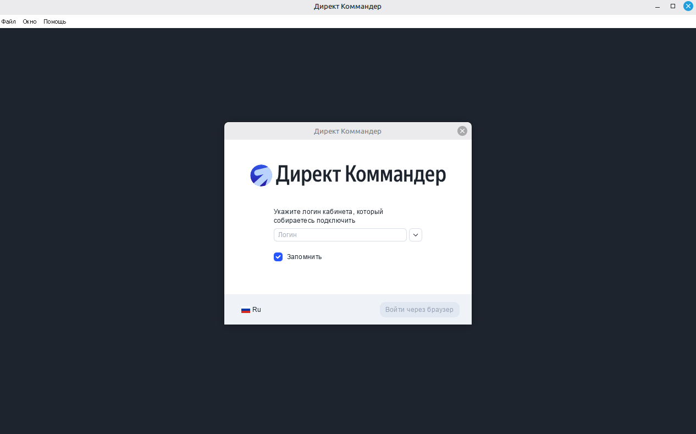
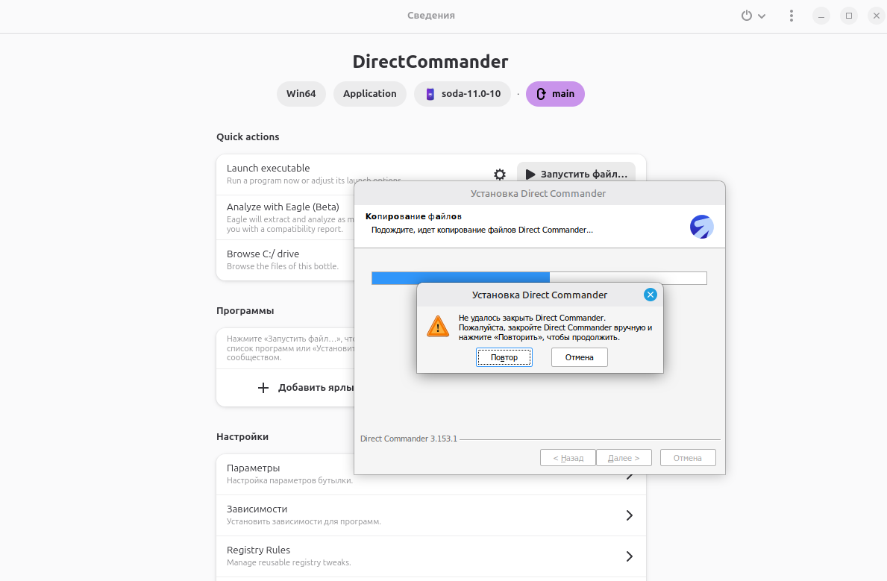
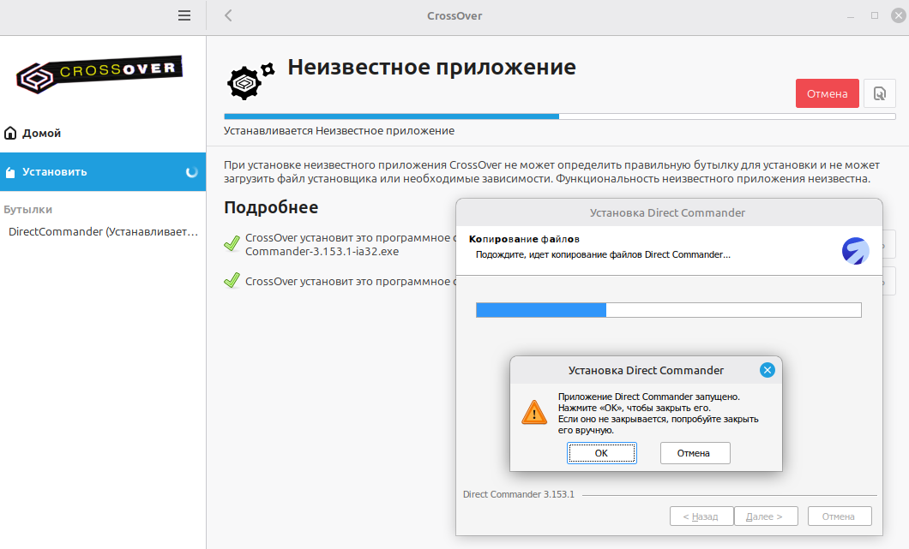

# Яндекс Директ Коммандер на Linux

Скрипты для установки и обновления Яндекс Директ Коммандера на Linux через [Bottles](https://usebottles.com/).



Официально Коммандер выпускается только под Windows и macOS. Штатный установщик под Wine не работает — он зацикливается на проверке «приложение уже запущено» и никогда её не проходит. Но сам Коммандер — это обычное Electron-приложение, которому установщик в принципе не нужен: достаточно распаковать его из инсталлятора и запустить напрямую.

Проверено на Linux Mint 22 (Ubuntu 24.04), Bottles 67.3, Директ Коммандер 3.153.1.

## Почему не получится установить обычным способом

Установка доходит до копирования файлов и упирается в диалог, из которого нет выхода: программа просит закрыть Директ Коммандер, которого не существует — он ещё даже не установлен.



Это не особенность Bottles. Тот же самый тупик воспроизводится в коммерческом CrossOver с его патченым Wine, на чистых префиксах, на любых сборках Wine и любых версиях Windows в профиле.



Поэтому установщик здесь не чинится, а обходится.

## Что делает скрипт

Распаковывает установщик в два прохода (внутри NSIS-инсталлятора лежит архив `app-32.7z` с готовым приложением), кладёт содержимое в бутылку Bottles, вытаскивает иконку из exe и создаёт скрипт запуска вместе с ярлыком в меню.

Ключевой момент, ради которого всё это и затевалось: запуск идёт через `/app/bin/wine` — **системную** сборку Wine из состава Bottles. На сборках, заточенных под игры (`soda` и подобные), которые Bottles предлагает по умолчанию, приложение стартует, отрабатывает инициализацию и молча умирает при создании первого окна — без окна, без ошибки, с нулевым кодом выхода.

## Установка

Понадобится Flatpak, Bottles и архиватор:

```bash
flatpak install flathub com.usebottles.bottles
sudo apt install -y p7zip-full icoutils
```

Затем в интерфейсе Bottles создайте бутылку с именем `Direct` и типом «Приложение» — больше там ничего трогать не нужно.

Скачайте установщик Коммандера для Windows с [официальной страницы Яндекса](https://yandex.com/project/commander/new), положите его в папку `Downloads` и **не запускайте**.

Дальше в терминале:

```bash
mkdir -p ~/GitHub && cd ~/GitHub
git clone https://github.com/cpa-jedi/direct-commander-linux.git
cd direct-commander-linux
./install.sh
```

Без аргументов скрипт сам возьмёт самый свежий установщик Коммандера из папки загрузок и покажет, какой файл нашёл. Если он лежит в другом месте, путь можно указать явно:

```bash
./install.sh /путь/к/файлу.exe
```

После установки Коммандер появится в меню приложений.

Если вы дали бутылке другое имя, передайте его скрипту (саму бутылку переименовывать не нужно):

```bash
BOTTLE_NAME=МоёИмя ./install.sh
```

## Обновление

Автообновление работать не будет: встроенный апдейтер запускает тот самый установщик, который под Wine зацикливается. Обновляйтесь вручную — закройте Коммандер, скачайте свежий установщик в ту же папку `Downloads` и выполните ту же команду:

```bash
cd ~/GitHub/direct-commander-linux
./install.sh
```

Файлы приложения заменятся, пользовательские данные останутся на месте.

Про обновления лучше не забывать: Яндекс периодически принудительно требует минимальную версию, иначе доступ к API закрывается.

## Удаление

```bash
./uninstall.sh
```

Пользовательские данные при этом сохраняются, путь к ним скрипт печатает в конце.

## Если не запускается

Первым делом запустите из терминала и посмотрите вывод:

```bash
BOTTLE="$HOME/.var/app/com.usebottles.bottles/data/bottles/bottles/Direct"
flatpak run --command=bash com.usebottles.bottles -c "
export WINEPREFIX='$BOTTLE'
cd '$BOTTLE/drive_c/Program Files (x86)/DirectCommander'
/app/bin/wine 'Direct Commander.exe' --enable-logging=stderr --v=1
echo \"EXIT: \$?\"
"
```

Код выхода `0` при отсутствующем окне означает, что процесс завершился штатно, а не упал — ищите не крэш, а причину выхода.

Полезнее всего собственный лог приложения:

```bash
tail -40 "$BOTTLE"/drive_c/users/*/AppData/Roaming/direct-commander/logs/$(date +%Y%m%d).log
```

Если он обрывается на строке `Required space = ...`, значит приложение умерло при создании первого окна — это и есть проблема с DirectComposition. Попробуйте флаг:

```bash
DC_ARGS=--disable-direct-composition direct-commander
```

Сообщения вида `err:module:use_lsteamclient`, `err:ole:com_get_class_object ... not registered`, `WSALookupServiceBegin failed with: 8` и россыпь `fixme:` — это нормальный шум Wine, он присутствует и на полностью рабочем запуске.

## Где лежат данные

Кампании, настройки и логи — внутри бутылки:

```
~/.var/app/com.usebottles.bottles/data/bottles/bottles/Direct/drive_c/users/<логин>/AppData/Roaming/direct-commander/
```

Эту папку имеет смысл включить в бэкап.

## Подробнее

Разбор того, почему установщик не работает, как искалась причина падения и что ещё было перепробовано (CrossOver, разные сборки Wine, флаги Chromium) — в статье: [ссылка].

## Обратная связь

Если по инструкции что-то не сработало — заведите [Issue](https://github.com/cpa-jedi/direct-commander-linux/issues). Так ответ останется на виду и поможет следующему, кто столкнётся с тем же.

Всё остальное — в телеграм: [@cpa_jedi](https://t.me/cpa_jedi).

## Лицензия

MIT — см. файл [LICENSE](LICENSE).

Лицензия распространяется только на скрипты из этого репозитория. Кода Яндекса здесь нет: скрипты работают с установщиком, который вы скачиваете сами с официального сайта, и ничего не распространяют.
